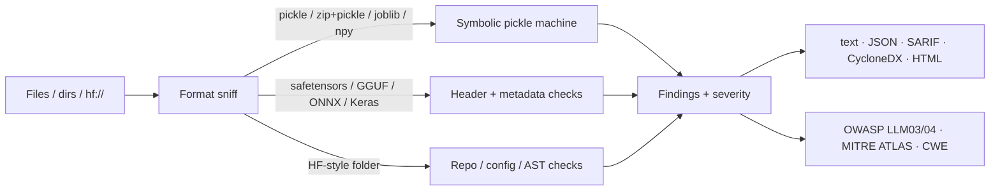

# loadsafe

**Audit ML model artifacts and model repos before you load them** — the way dependency scanners audit packages.

`loadsafe` statically inspects serialized models (pickle / PyTorch `.pt` / joblib / NumPy `.npy`, safetensors, ONNX, GGUF, Keras) and Hugging Face–style repositories, then emits a terminal report, JSON, **SARIF** (GitHub code scanning) and a **CycloneDX ML-BOM**. Findings map to [OWASP Top 10 for LLM Applications](https://genai.owasp.org/llm-top-10/) (LLM03 Supply Chain, LLM04 Data & Model Poisoning) and [MITRE ATLAS](https://atlas.mitre.org/) technique IDs.

> No API keys. Pure Python. Drop into CI as a build gate.

[](https://github.com/sushmit-gujar/loadsafe/actions/workflows/ci.yml)
[](LICENSE)

## Why

Model files are executable. A `.pt` / `.pkl` / `.joblib` is a pickle stream: loading it can run `os.system`, `eval`, or any other callable the attacker put in the `REDUCE`. Hugging Face has repeatedly pulled models that drop reverse shells on `torch.load`. Safetensors and GGUF close some of that door, but still carry parse-bug and chat-template-injection surface. Most teams still do the equivalent of `pip install` with no lockfile: `from_pretrained("org/name")` against a floating revision, often with `trust_remote_code=True`.

`loadsafe` is the missing pre-load gate:

| Threat | What loadsafe does |
|---|---|
| Pickle / PyTorch / joblib code execution | Symbolic pickle machine (not just opcode grepping) resolves `STACK_GLOBAL` / memo tricks, attributes every `REDUCE`/`NEWOBJ` to a callable + args, recurses into nested pickles, understands joblib's interleaved NumPy buffers |
| Disguised pickle (`.safetensors` that is actually a pickle) | Content sniffing + extension mismatch rule (`LS160`) |
| Malformed safetensors / GGUF / ONNX | Header, dtype/shape/offset, tensor-count and external-data checks without loading the model |
| Keras `Lambda` / unsafe modules | Config walk for marshalled bytecode and non-Keras `module` imports |
| Chat-template SSTI (CVE-2024-34359-class) | Jinja dunder / import pattern detection in GGUF metadata and `tokenizer_config.json` |
| `trust_remote_code` / custom modeling code | `auto_map`, dangerous AST calls, executables in the repo |
| Unpinned downloads | Flags `from_pretrained` / `snapshot_download` without `revision=<sha>` |

## Quickstart

```bash
pip install git+https://github.com/sushmit-gujar/loadsafe.git

# Scan a checkpoint or a model directory
loadsafe scan model.pt
loadsafe scan ./my-model-repo --fail-on high

# Hugging Face (optional extra)
pip install 'loadsafe[hf]'
loadsafe scan hf://org/name@<commit-sha>

# Machine-readable outputs
loadsafe scan ./model --format sarif -o loadsafe.sarif
loadsafe scan ./model --format cyclonedx -o ml-bom.json
loadsafe scan ./model --format html -o report.html
```

Exit code `1` when any finding is at or above `--fail-on` (default: `high`).

## Architecture



The pickle scanner is a small symbolic interpreter over the opcode stream (argument readers from `pickletools`). It tracks the stack, metastack and memo so `STACK_GLOBAL` operands and `REDUCE` targets are resolved even when they come from the memo — the failure mode of grepping for `os\nsystem` in the raw bytes. Unknown globals are **MEDIUM** by default (allowlist-or-deny, not deny-only), so novel gadgets still surface.

## CI integration

### GitHub Actions (fail the build + upload SARIF)

```yaml
- uses: actions/setup-python@v5
  with: { python-version: "3.12" }
- run: pip install git+https://github.com/sushmit-gujar/loadsafe.git
- run: loadsafe scan models/ --fail-on high --sarif loadsafe.sarif
- uses: github/codeql-action/upload-sarif@v3
  if: always()
  with: { sarif_file: loadsafe.sarif }
```

A ready-made workflow lives at [`.github/workflows/loadsafe.yml`](.github/workflows/loadsafe.yml).

### pre-commit

```yaml
# .pre-commit-config.yaml
- repo: https://github.com/sushmit-gujar/loadsafe
  rev: v0.1.0
  hooks:
    - id: loadsafe
```

## Evaluation (real runs on this machine)

Setup: Python 3.12.15, Linux x86_64, 8 vCPUs. PoC malicious artifacts are **generated at eval time** — nothing malicious is committed; payloads are inert (`builtins.print` or `echo … > $TMPDIR/loadsafe_poc_marker.txt`). Public models are downloaded read-only from Hugging Face at pinned commits.

```bash
python evals/run_eval.py --hf --compare   # reproduces evals/results.json
```

### Inert PoC corpus (18 malicious + 8 benign)

| Tool | Detection | False-positive rate | Notes |
|---|---:|---:|---|
| **loadsafe** | **100% (18/18)** | **0% (0/8)** | pickle / torch zip / npy / safetensors / GGUF / ONNX / Keras |
| picklescan 0.0.31 | 33% (6/18) | 0% (0/8) | pickle-only; misses format / SSTI / Keras / disguise cases |
| modelscan 0.8.8 | 44% (8/18) | 38% (3/8) | does not flag `print` / several non-pickle PoCs; FPs on benign ML pickles |

Corpus throughput for loadsafe: **2.7 MB/s** on ~9 KB of tiny files (per-file overhead dominates).

### Real public models (5 repos, 850.6 MB of weight files)

Pinned revisions of `hf-internal-testing/tiny-random-bert`, `hf-internal-testing/tiny-random-gpt2`, `sshleifer/tiny-gpt2`, `sentence-transformers/all-MiniLM-L6-v2`, `google/bert_uncased_L-2_H-128_A-2` (mix of `.bin` pickle and `.safetensors`).

| Metric | Value |
|---|---|
| False-positive rate (HIGH+) | **0% (0/5 repos)** |
| Scan throughput | **~3.2 GB/s** (header / pickle walk; weights are not executed) |
| Expected LOW findings | `LS107` / `LS213` advisories on pickle-based weights — informational, below `--fail-on high` |

Full machine-readable results: [`evals/results.json`](evals/results.json). Sample HTML + SARIF from a mixed PoC run: [`assets/sample-report.html`](assets/sample-report.html), [`assets/sample-report.sarif`](assets/sample-report.sarif).

## Rules (selection)

| ID | Severity | What |
|---|---|---|
| LS100 | CRITICAL | Dangerous callable invoked during unpickling (`REDUCE`/`NEWOBJ`/…) |
| LS101 | HIGH | Dangerous global imported by pickle |
| LS102 | MEDIUM/LOW | Non-allowlisted global |
| LS105 | HIGH | Nested pickle embedded in a pickle |
| LS107 | LOW | Artifact is pickle-based (prefer safetensors) |
| LS110/111 | HIGH | ZIP structure anomaly / unexpected executable member |
| LS120/121 | HIGH/MEDIUM | Invalid safetensors header / suspicious metadata |
| LS130/131 | HIGH/MEDIUM | ONNX path traversal / custom-domain op |
| LS140/141 | HIGH | Malformed GGUF / chat-template SSTI |
| LS150/151 | CRITICAL/HIGH | Keras Lambda bytecode / non-Keras module |
| LS160 | HIGH | Extension does not match content |
| LS200/201 | HIGH | `trust_remote_code` / dangerous call in repo Python |
| LS210/211/212 | MEDIUM/HIGH | Unpinned download / `trust_remote_code=True` / unsafe loader in consumer code |

`loadsafe rules` prints the full catalogue with OWASP / ATLAS / CWE mappings.

## Threat model & limitations

**In scope.** Static analysis of model artifacts and of the repository / consumer code that loads them, before any weight is executed. Intended as a CI / pre-commit / admission-control gate.

**Out of scope / known limits.**

- loadsafe does **not** execute models and will not catch pure weight-level backdoors (triggered by a specific input, no pickle gadget). Pair with behavioural tests for that.
- The pickle allowlist is finite. Unknown ML-library globals are MEDIUM (visible, not build-breaking). Tune with `--allow pkg.Class` / `--deny pkg.Class`.
- TorchScript / `torch.package` code objects are flagged at archive level (`LS112`); we do not fully interpret TorchScript IR.
- Keras HDF5 scanning is a heuristic JSON-in-blob search (no `h5py` required); prefer `.keras` zip.
- ONNX custom-op detection is domain/op-name based; we do not load `.so` custom ops.
- A determined attacker can still target bugs in *this* parser. Defense in depth: pin revisions, prefer safetensors, run loads inside a sandbox.

## Development

```bash
python -m venv .venv && source .venv/bin/activate
pip install -e ".[dev,eval]"
ruff check . && mypy src && pytest -q
```

CI runs on Python 3.10–3.13.

## License

MIT © 2026 Sushmit Gujar
